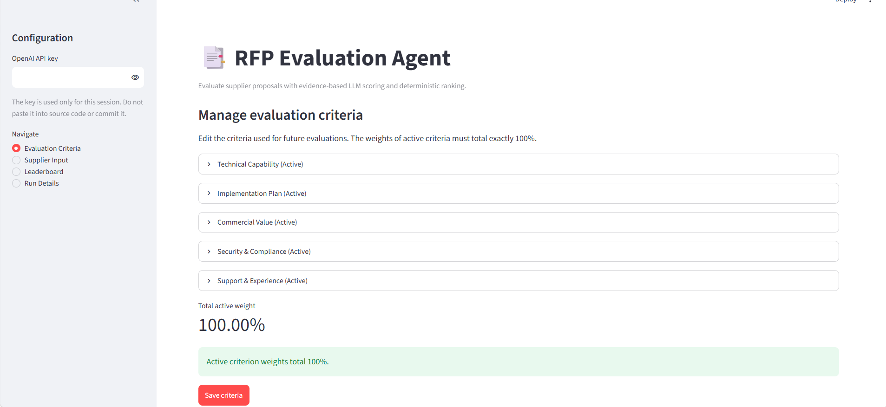
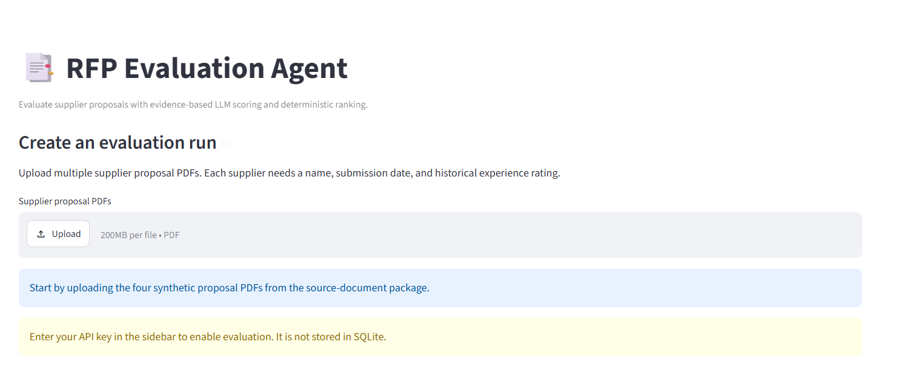
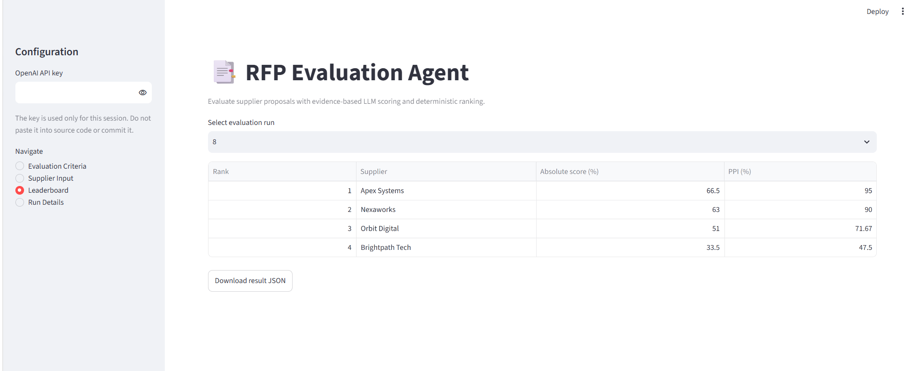
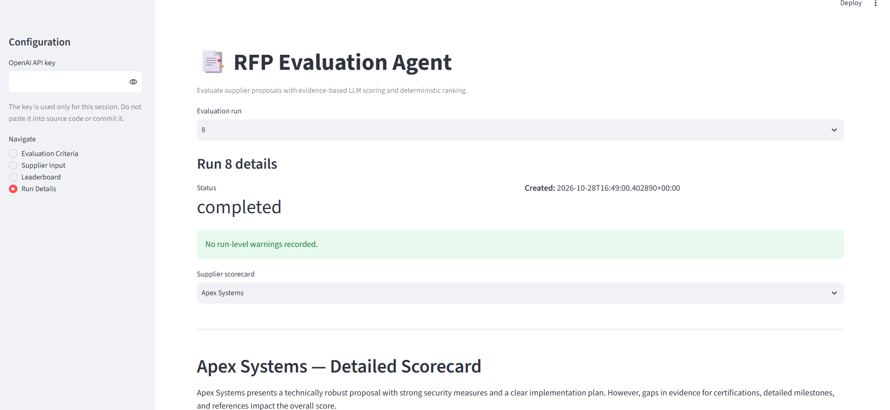
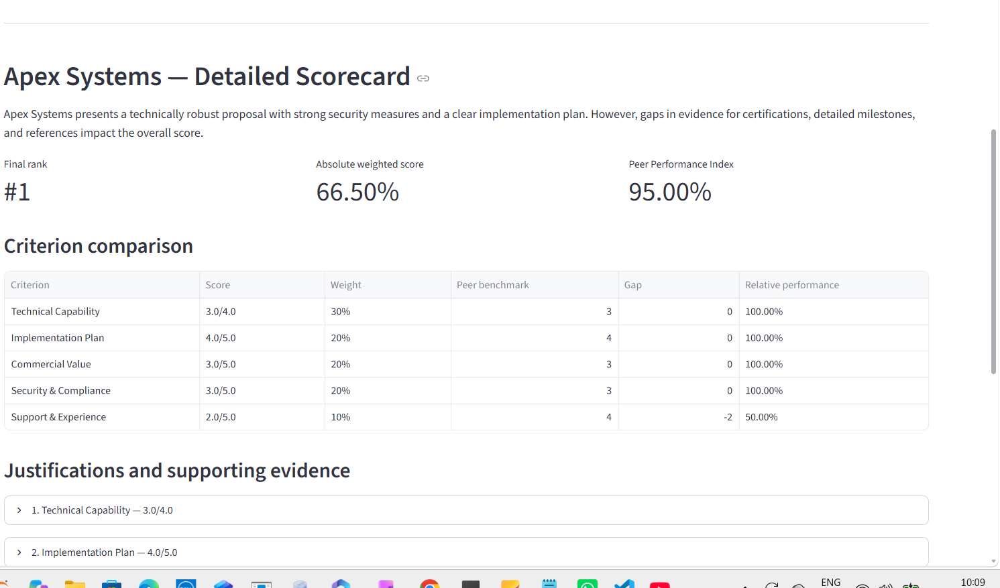
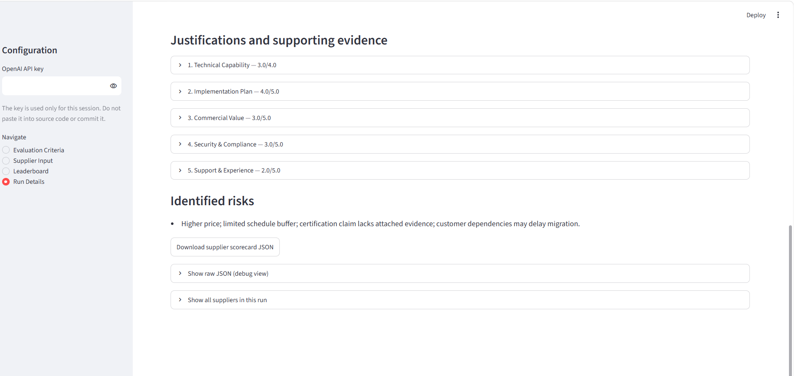

# RFP Evaluation Agent

A Streamlit application that evaluates supplier proposal PDFs against configurable criteria, generates evidence-based scorecards with an LLM, calculates weighted and peer-relative scores in Python, ranks suppliers deterministically, and stores evaluation runs in SQLite.

> **Demo data:** The included proposals and Run 8 output are synthetic examples. Scores are decision-support signals, not a substitute for procurement due diligence or human review.

## Features

- Configure criteria, descriptions, weights, maximum scores, and active status in the UI.
- Require active criterion weights to total 100% before evaluation.
- Upload multiple supplier proposal PDFs and provide supplier name, submission date, and historical experience rating.
- Extract text from PDFs and request a JSON scorecard from an LLM.
- Validate/normalize scorecards before scoring.
- Calculate weighted absolute scores, per-criterion peer benchmarks, gaps, relative performance, and Peer Performance Index (PPI) in Python.
- Apply deterministic ranking and tie-break rules.
- Persist criteria snapshots, run statuses, warnings, and supplier results in SQLite.
- Inspect supplier scorecards and download JSON results.
- Continue a batch when an individual supplier evaluation fails; save successful results and warnings.

## Technology

- Python 3.12
- Streamlit
- SQLite
- OpenAI Python SDK (JSON-mode chat completion)
- `pypdf` for PDF text extraction
- `pytest` for automated tests

## Architecture and data flow

1. **Streamlit UI (`app.py`)** — collects criteria, PDF files, supplier metadata, and API key.
2. **SQLite (`database/db.py`)** — seeds default criteria and stores criteria, run records, criteria snapshots, warnings, and results.
3. **Document tool (`src/document_tool.py`)** — extracts text from each PDF.
4. **Evaluation agent (`src/evaluation_agent.py`)** — sends the proposal text and active criteria to the LLM and requests JSON only.
5. **Validation (`src/validation.py`)** — validates the returned scorecard and handles missing/out-of-range values according to the implementation.
6. **Orchestrator (`src/orchestrator.py`)** — coordinates evaluation for a supplier.
7. **Batch processor (`src/batch_processor.py`)** — processes suppliers independently, collects warnings, and ranks successful evaluations.
8. **Scoring (`src/scoring.py`)** — performs all arithmetic, peer benchmarking, and ranking deterministically.
9. **Persistence and presentation** — results and warnings are saved in SQLite and presented in Leaderboard and Run Details screens.

The LLM evaluates proposal evidence; it does **not** calculate the final weighted score, peer benchmark, PPI, or rank.

## Default criteria

| Criterion | Weight |
|---|---:|
| Technical Capability | 30% |
| Implementation Plan | 20% |
| Commercial Value | 20% |
| Security & Compliance | 20% |
| Support & Experience | 10% |
| **Total** | **100%** |

Criteria and maximum scores can be changed in the UI. The weights of all active criteria must sum to 100%. Historical runs preserve the criteria snapshot used when the run was created.

## Scoring formulas

Let \(s_{ij}\) be supplier \(i\)'s score for criterion \(j\), \(m_j\) the configured maximum score, and \(w_j\) the criterion weight (as a fraction).

### Absolute weighted score

`Absolute score = Σ ((criterion score / criterion maximum) × criterion weight)`

The UI displays this value as a percentage. For example, `0.665` is displayed as `66.50%`.

### Peer benchmark, gap, and relative performance

- **Benchmark:** highest observed score for that criterion among successfully evaluated suppliers in the same batch.
- **Gap:** supplier criterion score minus the batch benchmark.
- **Relative performance:** `(supplier criterion score / benchmark) × 100`.
- **Zero benchmark:** the current implementation assigns 100% relative performance when the benchmark is zero, preventing division by zero.

### Peer Performance Index (PPI)

`PPI = Σ (criterion relative performance percentage × criterion weight)`

PPI is a peer-relative measure and can differ from the absolute weighted score. Because it uses the strongest score in the batch as the benchmark, it depends on which suppliers are included in that run.

### Deterministic ranking

The application sorts by:
1. Higher PPI first.
2. Earlier submission date first.
3. Higher historical experience rating first.
4. Supplier name in ascending, case-insensitive order.

Ranks `1, 2, 3, ...` are assigned after sorting. The LLM does not determine rank.

## Project structure

```text
.
├── app.py
├── requirements.txt
├── README.md
├── database/
│   ├── db.py
│   └── rfp_evaluation.db       # local runtime database; excluded from Git
├── src/
│   ├── batch_processor.py
│   ├── document_tool.py
│   ├── evaluation_agent.py
│   ├── orchestrator.py
│   ├── scoring.py
│   └── validation.py
├── tests/
│   ├── test_batch_processor.py
│   ├── test_database.py
│   ├── test_evaluation_agent.py
│   ├── test_scoring.py
│   ├── test_validation.py
│   └── test_workflow_integration.py
├── sample_proposals/
│   └── [four synthetic supplier PDFs]
├── sample_outputs/
│   └── rfp_run_8.json
└── screenshots/
    ├── 01_evaluation_criteria.png
    ├── 02_supplier_input.png
    ├── 03_leaderboard.png
    ├── 04_run_details.png
    ├── 05_detailed_scorecard.png
    └── 06_evidence_and_risks.png
```

## Run locally on Windows / VS Code

Open PowerShell in the project directory.

If the `rfp_agent` Conda environment already exists:

```powershell
conda activate rfp_agent
python --version
pip install -r requirements.txt
streamlit run app.py
```

If you need to create the environment:

```powershell
conda create -n rfp_agent python=3.12 -y
conda activate rfp_agent
pip install -r requirements.txt
streamlit run app.py
```

Open the local URL shown in the terminal, commonly `http://localhost:8501`.

Enter your OpenAI API key in the sidebar to enable evaluations. Do not put the key in source code or commit it. The app's sidebar input is intended for the current session and the key is not saved in SQLite.

## Run automated tests

From the project root with `rfp_agent` activated:

```powershell
python -m pytest -v
```

At the time this documentation was prepared, **15 tests passed**, including tests for batch failure handling, database persistence, LLM response validation, deterministic scoring, and workflow integration. Rerun the command after code changes and before submission.

## Sample output

`sample_outputs/rfp_run_8.json` is the actual JSON export provided for Run 8. It contains four ranked suppliers:

| Rank | Supplier | Absolute score | PPI |
|---:|---|---:|---:|
| 1 | Apex Systems | 66.50% | 95.00% |
| 2 | Nexaworks | 63.00% | 90.00% |
| 3 | Orbit Digital | 51.00% | 71.67% |
| 4 | Brightpath Tech | 33.50% | 47.50% |

The output reflects the criteria configuration and LLM scorecards used for that specific run. LLM scores can vary across separate evaluations; the Python scoring and ranking rules are deterministic once scorecards and metadata are fixed.

## Screenshots

### Evaluation criteria


### Supplier input


### Leaderboard


### Run details


### Detailed scorecard


### Evidence and risks


## Assumptions and limitations

- PDF text extraction works for text-based PDFs. Scanned/image-only PDFs may require OCR, which is not included in the current implementation.
- LLM-generated scores and justifications may be imperfect. Review evidence and risks before making procurement decisions.
- A scorecard's evidence is a text explanation from the proposal; the current implementation does not guarantee page-number citations.
- Peer benchmarks and PPI are batch-relative. Comparing PPI across different supplier batches may be misleading.
- A failed supplier is excluded from the successful suppliers' ranking and recorded as a warning. If all suppliers fail, the run is marked failed.
- SQLite is appropriate for a local demo. A hosted app's local filesystem may not provide durable database storage across restarts/redeployments; verify persistence requirements before relying on SQLite for public deployment.
- This is a learning/demo project, not a production procurement approval system.

## Deployment checklist

1. Push the reviewed source, tests, requirements, synthetic PDFs, sample JSON, README, and screenshots to a Git repository.
2. Ensure `.env`, API keys, and `database/*.db` are excluded by `.gitignore`.
3. Create the app on Streamlit Community Cloud and select the repository, branch, and `app.py` entry point.
4. Configure secrets securely if the app is changed to read a server-side key. Do not commit secrets.
5. Confirm dependency installation and test the deployed app with synthetic proposals.
6. Verify how database persistence behaves on the hosting platform before treating saved runs as durable.
7. Record the public app URL and capture a short demo of one successful evaluation and one validation/error case.

## Responsible use

Use only proposals that you are authorized to process. Do not upload confidential or personally identifiable supplier information to an external LLM unless your organization's policies permit it. Human review should remain part of the procurement decision.
