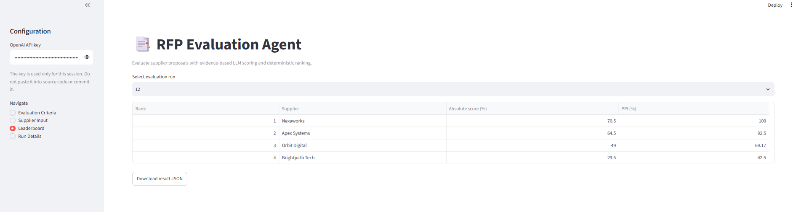
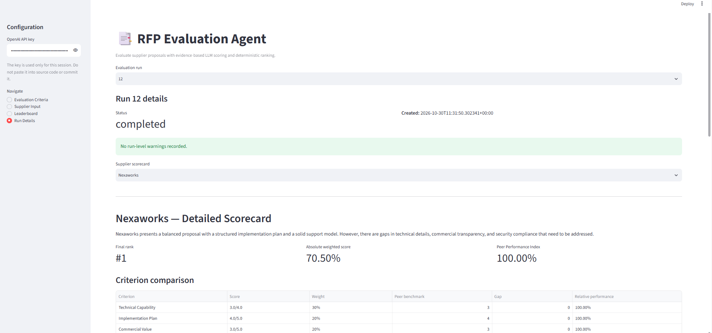
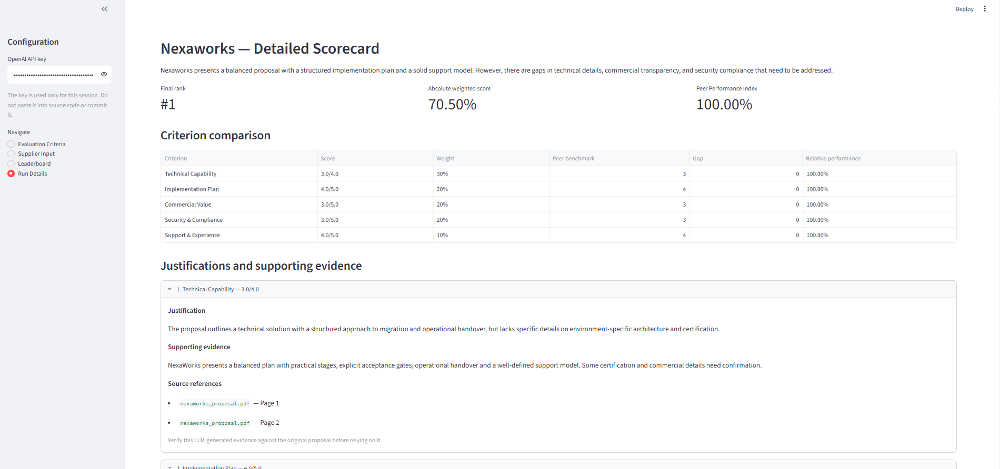
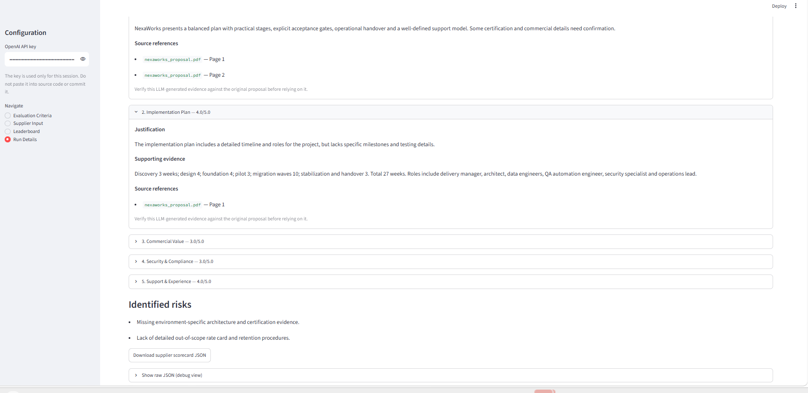
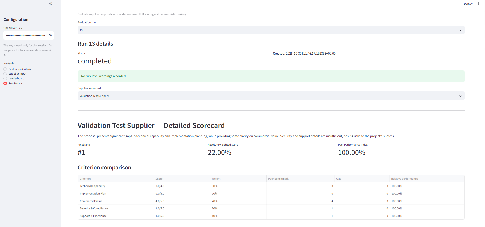
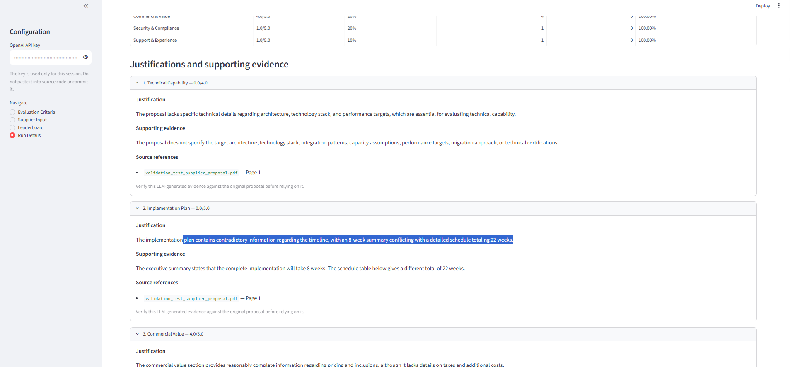
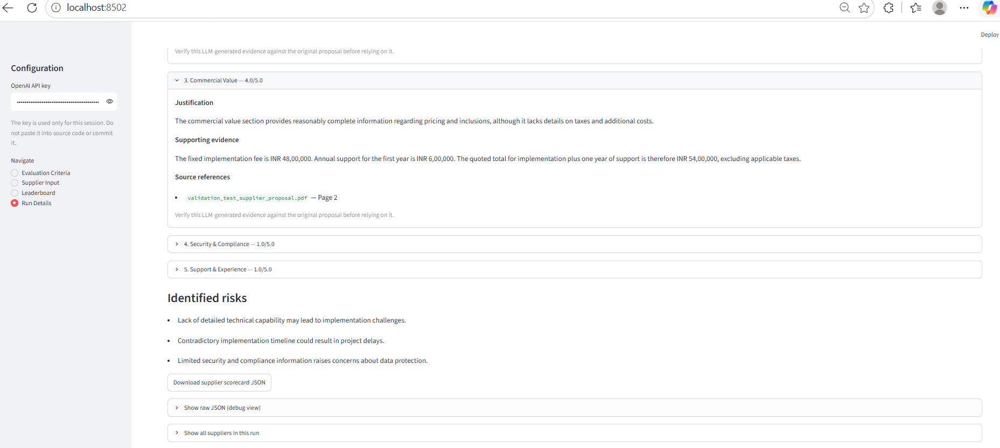

# RFP Evaluation Agent

A Streamlit application that evaluates supplier proposal PDFs against configurable criteria. It uses retrieval-augmented generation (RAG) to provide relevant proposal evidence to an LLM, validates the returned scorecards, calculates weighted and peer-relative scores in Python, ranks suppliers deterministically, and stores evaluation runs in SQLite.

> **Demo data:** The supplier proposals and validation-test proposal are synthetic. Scores are decision-support signals, not a substitute for procurement due diligence or human review.

## Features

- Configure evaluation criteria, descriptions, weights, maximum scores, and active status in the UI.
- Require active criterion weights to total 100% before evaluation.
- Upload multiple supplier proposal PDFs and provide supplier name, submission date, and historical experience rating.
- Extract text from PDFs page by page.
- Split proposal text into chunks, generate embeddings, and retrieve relevant evidence for each evaluation criterion.
- Use retrieved evidence as context for the LLM's criterion-level evaluation.
- Preserve source metadata and display the original PDF filename and page number for retrieved evidence.
- Validate and normalize LLM scorecards before scoring.
- Calculate weighted absolute scores, per-criterion peer benchmarks, gaps, relative performance, and Peer Performance Index (PPI) in Python.
- Apply deterministic ranking and tie-break rules.
- Persist criteria snapshots, run statuses, warnings, and supplier results in SQLite.
- Inspect detailed supplier scorecards and download JSON results.
- Continue a batch when an individual supplier evaluation fails; save successful results and warnings.

## Technology

- Python 3.12
- Streamlit
- SQLite
- OpenAI Python SDK
- OpenAI embeddings (`text-embedding-3-small`)
- `pypdf` for PDF text extraction
- `pytest` for automated tests

## Architecture and data flow

1. **Streamlit UI (`app.py`)** — collects evaluation criteria, supplier PDFs, supplier metadata, and the session API key; displays leaderboards and detailed scorecards.
2. **SQLite (`database/db.py`)** — seeds default criteria and stores criteria, run records, criteria snapshots, warnings, and supplier results.
3. **Document tool (`src/document_tool.py`)** — extracts text from PDFs while retaining original page numbers.
4. **RAG retriever (`src/rag_retriever.py`)** — chunks page text, creates embeddings in batches, calculates cosine similarity, and retrieves relevant chunks for each criterion.
5. **Orchestrator (`src/orchestrator.py`)** — coordinates evidence retrieval and supplier evaluation.
6. **Evaluation agent (`src/evaluation_agent.py`)** — sends the active criteria and retrieved proposal evidence to the LLM and requests a structured JSON scorecard. It maps returned source chunk IDs to trusted filename/page metadata from the retriever.
7. **Validation (`src/validation.py`)** — validates and normalizes the returned scorecard and preserves valid source references.
8. **Batch processor (`src/batch_processor.py`)** — processes suppliers independently, collects warnings, and ranks successful evaluations.
9. **Scoring (`src/scoring.py`)** — performs weighted scoring, peer benchmarking, PPI calculations, and ranking deterministically.
10. **Persistence and presentation** — results and warnings are saved in SQLite and presented in the Leaderboard and Run Details screens.

The LLM evaluates the retrieved proposal evidence. It does **not** calculate the final weighted score, peer benchmark, PPI, or rank. The application uses source chunk IDs to map evidence back to the original PDF filename and page number; users should still verify LLM-generated statements against the cited proposal pages.

## Default criteria

| Criterion | Weight |
|---|---:|
| Technical Capability | 30% |
| Implementation Plan | 20% |
| Commercial Value | 20% |
| Security & Compliance | 20% |
| Support & Experience | 10% |
| **Total** | **100%** |

Criteria and maximum scores can be changed in the UI. The weights of all active criteria must sum to 100%. Historical runs preserve the criteria snapshot used when the run was created.

## Scoring formulas

Let \(s_{ij}\) be supplier \(i\)'s score for criterion \(j\), \(m_j\) the configured maximum score, and \(w_j\) the criterion weight (as a fraction).

### Absolute weighted score

`Absolute score = Σ ((criterion score / criterion maximum) × criterion weight)`

The UI displays this value as a percentage. For example, `0.665` is displayed as `66.50%`.

### Peer benchmark, gap, and relative performance

- **Benchmark:** highest observed score for that criterion among successfully evaluated suppliers in the same batch.
- **Gap:** supplier criterion score minus the batch benchmark.
- **Relative performance:** `(supplier criterion score / benchmark) × 100`.
- **Zero benchmark:** the implementation assigns 100% relative performance when the benchmark is zero, preventing division by zero.

### Peer Performance Index (PPI)

`PPI = Σ (criterion relative performance percentage × criterion weight)`

PPI is a peer-relative measure and can differ from the absolute weighted score. Because it uses the strongest score in the batch as the benchmark, it depends on which suppliers are included in that run. A single-supplier run will have a PPI of 100% because that supplier is its own benchmark; this does not mean its proposal is excellent.

### Deterministic ranking

The application sorts by:

1. Higher PPI first.
2. Earlier submission date first.
3. Higher historical experience rating first.
4. Supplier name in ascending, case-insensitive order.

Ranks `1, 2, 3, ...` are assigned after sorting. The LLM does not determine rank.

## Project structure

```text
rfp-evaluation-agent-starter/
├── app.py
├── requirements.txt
├── README.md
├── SOLUTION_SPEC.md
├── .env.example
├── .gitignore
├── database/
│   ├── __init__.py
│   └── db.py
├── src/
│   ├── __init__.py
│   ├── batch_processor.py
│   ├── document_tool.py
│   ├── evaluation_agent.py
│   ├── orchestrator.py
│   ├── rag_retriever.py
│   ├── scoring.py
│   └── validation.py
├── tests/
│   ├── test_batch_processor.py
│   ├── test_database.py
│   ├── test_evaluation_agent.py
│   ├── test_rag_integration.py
│   ├── test_rag_retriever.py
│   ├── test_scoring.py
│   ├── test_validation.py
│   └── test_workflow_integration.py
├── sample_proposals/
│   ├── apex_systems_proposal.pdf
│   ├── brightpath_tech_proposal.pdf
│   ├── nexaworks_proposal.pdf
│   ├── orbit_digital_proposal.pdf
│   └── synthetic_manifest.json
├── sample_outputs/
│   ├── rfp_run_3.json
│   └── rfp_run_8.json
└── screenshots/
    ├── 01_evaluation_criteria.png
    ├── 02_supplier_leaderboard.png
    ├── 03_run12_completed_overview.png
    ├── 04_run12_detailed_scorecard.png
    ├── 05_run12_evidence_and_identified_risks.png
    ├── 06_run13_completed_scorecard.png
    ├── 07_run13_missing_evidence_and_timeline_conflict.png
    └── 08_run13_commercial_evidence_and_risks.png
```

The SQLite database is created at runtime in the `database/` directory and is excluded from Git. Do not commit API keys or confidential supplier data.

## Run locally on Windows / VS Code

Open PowerShell in the project directory.

If the `rfp_agent` Conda environment already exists:

```powershell
conda activate rfp_agent
python --version
pip install -r requirements.txt
streamlit run app.py
```

If you need to create the environment:

```powershell
conda create -n rfp_agent python=3.12 -y
conda activate rfp_agent
pip install -r requirements.txt
streamlit run app.py
```

Open the local URL shown in the terminal, commonly `http://localhost:8501`.

Enter your OpenAI API key in the sidebar to enable evaluations. Do not put the key in source code or commit it. The app's sidebar input is intended for the current session and the key is not saved in SQLite.

## Run automated tests

From the project root with `rfp_agent` activated:

```powershell
python -m pytest -v
```

The current test suite contains **28 passing tests** (verified on 30 October 2026). Tests cover batch failure handling, database persistence, LLM response validation, retrieved evidence and PDF source mapping, RAG chunking and similarity, deterministic scoring, and workflow integration. Rerun the command after code changes and before submission.

## Sample evaluation runs

- `sample_outputs/rfp_run_3.json` and `sample_outputs/rfp_run_8.json` are earlier synthetic evaluation exports.
- The screenshots also show Run 12, a four-supplier completed evaluation with criterion-level evidence and PDF page references.
- Run 13 uses a deliberately incomplete synthetic proposal to demonstrate how the evaluator handles missing technical details, a conflicting implementation timeline, and a more complete commercial section.

For Run 13, the synthetic proposal states an 8-week implementation in its summary while its phase schedule totals 22 weeks. The scorecard identifies this contradiction. The commercial section states an implementation fee of INR 48,00,000 and first-year support of INR 6,00,000, for a stated combined total of INR 54,00,000 excluding taxes.

LLM-generated evaluations may vary between runs. The Python scoring and ranking calculations are deterministic for fixed scorecards and supplier metadata.

## Screenshots

### 1. Evaluation criteria


Shows configurable evaluation criteria, active status, weights, and total active weight validation.

### 2. Supplier leaderboard



Shows supplier rankings, absolute weighted scores, Peer Performance Index (PPI), and JSON download option.

### 3. Run 12 completed overview



Shows a completed four-supplier evaluation run.

### 4. Run 12 detailed scorecard



Shows criterion-level scores, weights, peer benchmarks, gaps, and relative performance.

### 5. Run 12 evidence and identified risks



Shows LLM-generated justifications, supporting evidence, source filenames and PDF page references, and identified supplier risks.

### 6. Run 13 validation-test scorecard



Shows the completed evaluation of the deliberately incomplete synthetic test proposal.

### 7. Missing technical evidence and conflicting timeline



Shows that missing technical details and the conflicting 8-week versus 22-week implementation timeline were identified.

### 8. Commercial evidence and identified risks



Shows extraction of the commercial amounts and the proposal's identified risks.

## Assumptions and limitations

- PDF text extraction works for text-based PDFs. Scanned/image-only PDFs may require OCR, which is not included in the current implementation.
- RAG retrieval depends on the quality of PDF text extraction, chunking, embeddings, and similarity ranking. Relevant evidence may be missed.
- Retrieved source references identify the PDF pages containing the selected chunks. They do not independently prove that every LLM-generated sentence is fully supported by those pages.
- LLM-generated scores, justifications, and risks may be imperfect. Review the original proposal pages before making procurement decisions.
- Peer benchmarks and PPI are batch-relative. Comparing PPI across different supplier batches may be misleading.
- A failed supplier is excluded from the successful suppliers' ranking and recorded as a warning. If all suppliers fail, the run is marked failed.
- SQLite is appropriate for a local demo. A hosted app's local filesystem may not provide durable database storage across restarts/redeployments; verify persistence requirements before relying on SQLite for public deployment.
- This is a learning/demo project, not a production procurement approval system.

## Deployment checklist

1. Push the reviewed source, tests, requirements, synthetic PDFs, sample JSON, README, and screenshots to the Git repository.
2. Ensure `.env`, API keys, and `database/*.db` are excluded by `.gitignore`.
3. Configure the Streamlit Community Cloud app to use the intended repository, branch, and `app.py` entry point.
4. Configure secrets securely if the app is changed to read a server-side key. Do not commit secrets.
5. Confirm dependency installation and test the deployed app with synthetic proposals.
6. Verify how database persistence behaves on the hosting platform before treating saved runs as durable.
7. Record the public app URL and capture a short demonstration of one successful evaluation and one evidence-quality/validation test case.

## Responsible use

Use only proposals that you are authorized to process. Do not upload confidential or personally identifiable supplier information to an external LLM unless your organization's policies permit it. Human review should remain part of the procurement decision.
